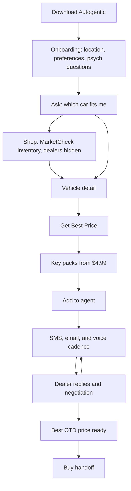

# Drevvy shopper journey

Drevvy is a shopper-only app. A person downloads Autogentic, figures out which car fits, shops live MarketCheck inventory without seeing the store, and buys a one-time generic key pack (1/$4.99, 5/$19.99, 10/$34.99 recommended, 25/$74.99). Spend kind is assigned at use: market intel on any VDP, or in-app dealer conversation when the listing URL matches an onboarded rooftop. Off-network OTD requests are free and are not chat. Packs never expire. In-network dealers see the shopper first name only. The shopper sees prices, stage, and summaries. The operator sees the stores, the raw threads, and the cadence.

Sign in with Apple is postponed until App Store submission. The demo does not depend on it. A shopper can move through Ask, Shop, and the Deals tab on this story without an Apple account.

## What each side can see

| Step | Shopper sees | Admin sees |
| --- | --- | --- |
| Download and open | The chat home. No account wall for the demo. | Nothing yet, until signup is recorded. |
| Onboarding | City or ZIP, budget, body style, must-haves, and a few psych questions about how they buy. | Answers, completion, and the signup time. No dealer data. |
| Ask | A chat answer grounded in year, make, model, price, and miles. | The same answer, plus the prompt cost when we measure it. |
| Shop | Map and cards. Price, photos, city, and distance. No store name, phone, or website. | The same cards. Dealer identity stays off the shopper payload. |
| Vehicle detail | Specs, photos, days on market, price history if we have it. | Market comps and the leverage line the agent can quote later. |
| Get Best Price | A tap that means “have Drevvy get the out-the-door number.” | The tap, the listing id, and the listed price snapshot. |
| Paywall | One-time generic key packs: 1/$4.99, 5/$19.99, 10/$34.99, 25/$74.99. Never expire. | Paywall shown, then the pack purchased or not. MRR is a placeholder until payments are real. |
| Add to agent | A deal card: starting price, best OTD, savings, status chip, last activity. | That card, plus store names. |
| Outreach | “3 dealerships contacted, 1 replied.” Counts by SMS, email, and voice. Summaries, not transcripts. | The stores, phone, email, raw transcripts, cadence, and agent notes. |
| Best price | The lowest out-the-door total, the fee breakdown, and the offer trend. | Which store gave which number, and the next agent step. |
| Buy | A handoff only after the shopper says they want the car. | The same decision, with the store contact still hidden until that yes. |

Status chips on the deal card are Reaching out, Negotiating, Offer received, Best price ready, and Paused.

## Steps

### Download

The shopper installs Autogentic. The first screen is the chat, not a dealer portal.

Events: none required. A later `shopper.signed_up` row in `app_events` marks the account, with `source = dashboard` and `payload.consumer_user_id`.

Stored: nothing until onboarding or signup. Sign in with Apple, when it ships, writes `consumer_profiles` and keeps email in Supabase Auth.

MarketCheck: not used.

### Onboarding

The shopper sets a location, a budget, body-style preferences, and a few questions about how they decide (payment style, timeline, how much they want Drevvy to push).

Shopper sees the questions and a short confirmation. Admin sees that onboarding finished and the answers.

Event: `shopper.onboarding_completed`.

Stored: preferences on the shopper profile when that table exists. The demo can keep them in app state. Do not copy them onto a dealer record.

MarketCheck: the location becomes the search center later. It is not a dealer id.

### Ask

Ask is the research chat. “What fits a family of four under $30k near Charlotte?” The answer uses year, make, model, price, and miles. It does not name a store.

Event: `shopper.ask_or_shop` with a payload flag `mode = ask`. Existing chat traffic may already be in `app_events` from the dashboard chat-search route. Reuse that stream instead of a second log.

Stored: the message and the search filters. Not a deal yet.

MarketCheck: chat-search reads inventory through the dashboard. Dealer fields are stripped before the response.

### Shop

Shop is the inventory search. Cards and the map show price, photos, city or region, and distance. The shared inventory response leaves `dealerName` empty and drops phone, website, and street address.

Event: `shopper.ask_or_shop` with `mode = shop`, then `shopper.vehicle_viewed` when a card opens.

Stored: search filters and the listing ids that were shown. Dealer ids stay on the server if a later job needs them. They are not in the shopper JSON.

MarketCheck: `search_active_cars` for the radius. Photos and price come from the listing. Comps are not required on the card.

### Vehicle detail

The shopper opens one car. They see specs, photos, the listed price, days on market, and city. They do not see the store.

Event: `shopper.vehicle_viewed` with `vehicle_id` and `vin`.

Stored: the listing id. A deal snapshot is not written until Get Best Price and payment.

MarketCheck: detail enrichment (specs, days on market, price drops). The admin deal page also has a leverage line, for example “3 similar units within 50mi are listed about $1,800 lower.” That line is for the agent. The shopper can see days on market and a plain price context. They still do not see who is selling the comps.

### Get Best Price

On an in-network rooftop the shopper can unlock market intel (one key) or start in-app chat (one key). Off-network they can unlock market intel (one key) or request the dealership’s out-the-door number for free — that request is analytics only, not chat. If their key balance is 0, intel and conversation open the pack picker.

Event: `shopper.get_best_price`.

Stored: listing id, listed price, year, make, model, trim, miles, city, state. No dealer name.

MarketCheck: the listed price and days on market are copied onto the deal so later quotes have a starting point even if the listing changes.

### Paywall

One-time generic key packs: 1 key for $4.99, 5 for $19.99, 10 for $34.99 (recommended), 25 for $74.99. Spend kind is assigned at use. Packs never expire. The shopper sees the prices. They do not see dealer outreach on this screen.

Event: `shopper.paywall_shown`, then `shopper.subscribed` when payment succeeds. Payments are not built. The admin MRR and churn figures are placeholders from mock subscription status.

Stored: subscription status on the shopper, when billing exists. Until then the admin mock marks active, paywall shown, onboarding, or canceled.

MarketCheck: not used.

### Add to agent

The car becomes a deal card. Starting price is the listed price. Best OTD and savings fill in as quotes arrive. The status chip starts at Reaching out. Last activity updates on each touch.

The cap is 10 open cars. The admin shopper table shows N/10.

Event: `shopper.deal_added`.

Stored: `shopper_deals` (listing id, vehicle snapshot, status, `outreach_locked_until_paid`). The admin console does not write this table. It reads fixtures. A later migration, `20261006_shopper_outreach.sql`, adds messages, offers, and events. It is not applied.

MarketCheck: the snapshot is the non-dealer listing fields. The leverage citation is attached for the agent.

### Outreach

Drevvy contacts stores. The shopper never sees which ones.

Cadence:

1. Day 0: intro SMS and an email that asks for an itemized out-the-door total.
2. Day 1: a voice call if nobody has replied.
3. Day 3: a price-check SMS.
4. Day 5: a follow-up email if the quote is still incomplete.
5. Escalate to a manager call only after the written steps have had a chance to land.
6. Stop when the shopper pauses the car, the car is won, or the best price is ready and the agent is told to hold.

Shopper sees contacted count, replied count, SMS/email/voice counts, an AI summary of the texts, an AI summary of the emails, and a timeline that says “a dealership replied.”

Admin sees the store name, phone, email, the cadence row for each store, the raw transcript, the agent’s decision notes, and the full timeline.

Events: each touch can be `shopper.dealer_replied` for the first inbound. Channel and cadence live on the outreach rows, not in the shopper card.

Stored: `shopper_outreach_messages` once that migration is applied. Until then, fixtures only. Do not seed them into production.

MarketCheck: the agent can cite days on market, price drops, nearby comp count, and the leverage score. Example: “3 similar units within 50mi are listed about $1,800 lower.” Live comps run only if `MARKETCHECK_LIVE=1`. Otherwise the deal page shows the mock insight.

### Replies and the negotiation loop

A store answers. The agent asks for fees, compares the number to the comps, and counters the lowest store. The shopper’s chip moves to Negotiating, then Offer received when an itemized out-the-door quote is in.

Shopper sees the offer trend without store names, and the fee breakdown: negotiated price, doc fee, estimated tax, title, registration, out the door. Savings versus listed price is the cut in the vehicle price, not a promise that tax disappeared.

Admin sees which store sent which number.

Event: still on the deal timeline. `shopper.best_price_ready` fires when the agent stops shopping the number.

Stored: `shopper_offers` for the chart. LLM and voice cost per deal is a measured estimate when we have token and minute counts. The mock uses a small dollar figure per message so the admin analytics page has a slot.

MarketCheck: refresh comps if the listing price drops while the thread is open. Do not show the comp’s seller.

### Best price and buy

Best price ready means the lowest out-the-door total is on the card. The next step is to ask the shopper if they want to move forward. Paused means no new texts or calls.

Bought or won is `shopper.won`. The store’s name and phone are revealed only after the shopper confirms they want that car. Until then the handoff screen talks about “the dealership” and the price.

Admin sees the decision to hold, counter, or hand off.

## Analytics map

The admin Analytics page reads the same funnel. When these events exist in `app_events`, count distinct `payload.consumer_user_id` per name. `app_sessions` remains the session key (`flow_id`).

| Funnel step | app_events.event_name |
| --- | --- |
| Signup | `shopper.signed_up` |
| Onboarding | `shopper.onboarding_completed` |
| First Ask or Shop chat | `shopper.ask_or_shop` |
| First car viewed | `shopper.vehicle_viewed` |
| Get Best Price | `shopper.get_best_price` |
| Paywall shown | `shopper.paywall_shown` |
| Subscribed | `shopper.subscribed` |
| First car added | `shopper.deal_added` |
| First dealer reply | `shopper.dealer_replied` |
| Best price ready | `shopper.best_price_ready` |
| Bought or won | `shopper.won` |

Also on the admin analytics page: deals by stage, average savings in dollars and percent versus listed price, median time to first dealer response, median time to best price, response rate by SMS/email/voice, cadence reply rate, messages per deal, active cars versus the 10-car cap, MRR and churn placeholders, and LLM cost per deal.

## Where this is demoed

`/admin` is the operator console. It is not the dealer dashboard under `/app`. Access is `ADMIN_EMAILS` on the Supabase session. The pages in this PR use mock shoppers and the 19 vehicles in `apps/dealer-dashboard/src/lib/admin/fixtures/demo-vehicles.json`. Those vehicles were exported from `uvs_vehicles` with dealer names already removed. The mock stores are fictional. Nothing is written to production Supabase.
